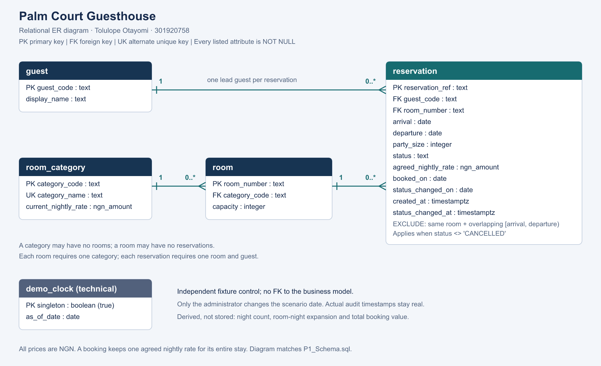

# Portfolio 1 — Database design and modelling

**Tolulope Otayomi · 301920758 · Palm Court Guesthouse**

Portfolio 1 implements a PostgreSQL model for a fictional guesthouse. It stores guests, categories, rooms and reservations; a separate fixture clock makes date-dependent examples reproducible. A booking stores its complete stay interval and agreed nightly rate. PostgreSQL rejects overlapping non-cancelled stays in the same room.

## Design artifacts

- [Case study and business policies](Otayomi_Tolulope_301920758_P1_CaseStudy.md).
- [Relational design, keys, cardinalities and enforcement](Otayomi_Tolulope_301920758_P1_RelationalDesign.md).
- [Normalisation from UNF through 3NF](Otayomi_Tolulope_301920758_P1_Normalisation.md).
- [ER diagram — editable SVG](Otayomi_Tolulope_301920758_P1_ERDiagram.svg) and [PNG](Otayomi_Tolulope_301920758_P1_ERDiagram.png).

## Run and inspect

Follow the [environment guide](../Otayomi_Tolulope_301920758_Environment.md). Run these files in order in the dedicated empty project database:

1. [Schema](Otayomi_Tolulope_301920758_P1_Schema.sql) — relations, constraints, triggers, protected operations and operator permissions. Fails if the schema already exists; does not delete earlier work.
2. [Seed](Otayomi_Tolulope_301920758_P1_Seed.sql) — fictional records and lifecycle history. One transaction; not an automatic reset.
3. [Constraint tests](Otayomi_Tolulope_301920758_P1_ConstraintTests.sql) — positive and negative cases, exact expected error/constraint checks, and final state output. Test changes roll back.

The demonstration business date ends at **1 December 2026**. Actual evidence was executed on **15 November 2026**. November/December stay dates describe a synthetic scenario, not a claim that those bookings or historical actions occurred in the real world. The fixture clock is administrator-controlled; recorded audit timestamps still use the actual database clock.

## Actual results

The [main execution output](Otayomi_Tolulope_301920758_P1_Results.txt) records **47 passing checks**. Expected rejections verify SQLSTATE and, where relevant, the specific constraint name, so an unrelated failure cannot masquerade as the intended validation.

| Area                 | Observed outcome                                                                                                                                                                                |
| -------------------- | ----------------------------------------------------------------------------------------------------------------------------------------------------------------------------------------------- |
| Basic integrity      | Duplicates, required fields, bad references, invalid capacity and invalid money rejected.                                                                                                       |
| Dates and allocation | Empty/reversed/unbounded stays and past arrivals rejected. Equal, contained and partial overlaps rejected; adjacent stays and different rooms accepted.                                         |
| Lifecycle/history    | Cancellation releases nights and retains price history. Completion works on departure date. Premature completion, cancellation on arrival, terminal-state reversal and edits/deletion rejected. |
| Pricing              | Category rate changes affect a new booking while the earlier agreed rate remains unchanged.                                                                                                     |
| Atomic failure       | A failed multi-step operation leaves neither the test guest nor a partial reservation.                                                                                                          |
| Operator access      | Direct writes, history truncation and fixture-clock updates rejected; an authorized booking operation succeeds.                                                                                 |
| Post-test state      | Original 8 guests, 3 categories, 12 rooms and 10 reservations retained. Reservations: 7 confirmed, 2 completed, 1 cancelled.                                                                    |

The [clean replay output](Otayomi_Tolulope_301920758_P1_Replay.txt) records schema, seed and the same 47 checks in a second empty database. All business records match the main database exactly after tests. Real audit timestamps are excluded from this equality comparison because separate runs occur at different times.

## Interpretation and remaining work

The tests support the implemented P1 integrity rules. The partial exclusion constraint lets a cancelled record remain in history without blocking its replacement; completed records still protect their historical nights. Capturing one rate per stay avoids changing earlier agreements when catalogue prices change.

This batch does not demonstrate two simultaneous database sessions, measure query optimisation, implement NoSQL events or deploy cloud services. Those belong to P2–P5. No production authentication system is provided; the operator is a `NOLOGIN` database role, while the trusted administrator controls the fixture clock and setup.

Verification includes a visual check of the SVG/PNG diagram and Prettier for authored Markdown/SVG. SQL is formatted with consistent indentation and verified by PostgreSQL execution; raw database outputs are preserved.

Technical sources: PostgreSQL [constraints](https://www.postgresql.org/docs/17/ddl-constraints.html), [ranges](https://www.postgresql.org/docs/17/rangetypes.html), [btree_gist](https://www.postgresql.org/docs/17/btree-gist.html), [triggers](https://www.postgresql.org/docs/17/plpgsql-trigger.html), and [function security](https://www.postgresql.org/docs/17/sql-createfunction.html#SQL-CREATEFUNCTION-SECURITY). The explanations and fixtures apply those mechanisms to this project's original guesthouse case.
