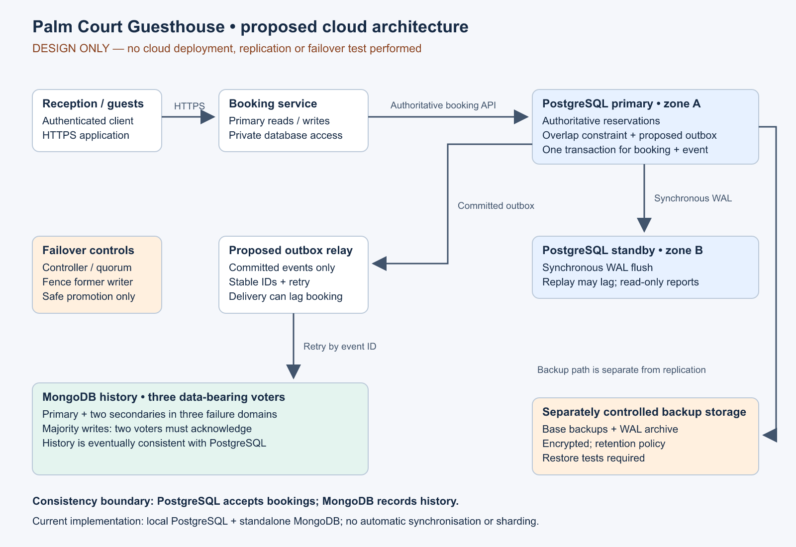

# Portfolio 5 — Proposed distributed and cloud architecture

**Tolulope Otayomi · 301920758 · Palm Court Guesthouse**

**Status: design discussion only.** P1–P4 ran on one local computer. No cloud service, replica set, failover, backup restoration or sharding was deployed or tested. The following proposal applies the assessment's discussion option to the same guesthouse.

[Scalable SVG diagram](Otayomi_Tolulope_301920758_P5_Architecture.svg).

## Placement and ownership

For the current 12-room property, one PostgreSQL writer is sufficient. A cloud version would put the booking service and databases on private networks, expose only the authenticated application endpoint, and use managed secrets, TLS and separate booking/reporting roles. Guest-facing traffic would never connect directly to a database. No provider, paid resource or service-level guarantee is selected here.

PostgreSQL would own availability, accepted reservations and agreed prices. Booking reads and writes would use its primary endpoint and retain the exclusion constraint demonstrated in P3. Read-only reports could use a standby if their interface clearly indicated possible lag; its displayed availability would never authorise a reservation.

## Replication, consistency and partitions

| Component        | Proposed arrangement                                                                                             | Guesthouse trade-off                                                                                                             |
| ---------------- | ---------------------------------------------------------------------------------------------------------------- | -------------------------------------------------------------------------------------------------------------------------------- |
| PostgreSQL       | Primary in zone A and synchronous standby in zone B; `synchronous_commit=on` with a required synchronous standby | Acknowledgement waits for standby WAL flush, increasing latency and potentially blocking commits when the standby is unavailable |
| Failover control | Managed orchestration or a separately tested quorum-based controller; fence the former writer before promotion   | Avoid two active booking authorities; fail closed when safe ownership cannot be established                                      |
| MongoDB history  | Three data-bearing voting members across three failure domains; primary plus two secondaries                     | Majority writes can continue with two members; minority partitions cannot acknowledge majority writes                            |
| Outbox relay     | Retryable delivery of committed SQL events using stable event IDs                                                | Booking can succeed while history delivery is delayed; retries must not duplicate history                                        |

PostgreSQL streaming replication can be asynchronous or synchronous. With an asynchronous fallback, recent acknowledged bookings could be lost on primary failure; with the proposed synchronous setting, commit availability depends on a suitable standby. Standby replay can still lag WAL receipt, so durable acknowledgement is not a promise that a report has already applied the change. These are explicit design trade-offs from [PostgreSQL replication](https://www.postgresql.org/docs/17/warm-standby.html), not measured outcomes here.

Promotion requires more than changing a connection string. The old writer must be fenced, client routing must change, and a standby must be re-established afterwards. PostgreSQL does not itself provide the complete failure-detection/orchestration system. The proposal therefore requires the controls described in its [failover documentation](https://www.postgresql.org/docs/17/warm-standby-failover.html).

For MongoDB, the proposed writer would request `{w: "majority", j: true, wtimeout: 5000}`. Majority acknowledgement in this three-voter design requires two data-bearing members. A timeout is an uncertain acknowledgement, not proof that the write did not occur; retries use the same event ID. Elections interrupt writes temporarily, and majority-read history can still be behind the booking service. This follows MongoDB's [replica-set model](https://www.mongodb.com/docs/v7.0/replication/) and [write-concern semantics](https://www.mongodb.com/docs/v7.0/reference/write-concern/).

During a network partition, accepting bookings independently on both sides would threaten the no-overlap rule. This design prioritises one authoritative writer and confirmed durability over uninterrupted booking acceptance. History and lag-tolerant reports may remain available independently, with their stale state made visible.

## Proposed SQL-to-document delivery

A future booking transaction would insert both the reservation change and an outbox record in PostgreSQL, committing them together. A relay would deliver only committed records to MongoDB and mark delivery after acknowledgement. A crash between delivery and marking could cause a retry; the stable event ID and unique reservation/sequence pair would make it recognisable. A same-ID/different-content event would be quarantined for investigation instead of silently overwriting history.

Sequence numbers would be allocated while serialising changes to each reservation. A consumer would order history by sequence and detect missing events. Booking success would depend on PostgreSQL, while history could catch up later. There is no cross-database atomic commit in this proposal. The P4 fixture manually reconstructs events; neither the outbox nor relay is implemented.

## Scaling and recovery

Sharding would add unnecessary complexity for 12 rooms. First measure demand, tune queries and increase resources; P2 demonstrates a selective index rather than a need to distribute this workload. If the system later served many properties, placing each property's bookings together could preserve local overlap checks, but a busy property could become a hotspot. PostgreSQL's current exclusion constraint does not automatically enforce a rule across independent shards.

For a future large MongoDB history store, shard-key selection would need to balance property/booking queries, cardinality and write distribution; a constant single-property key would provide little distribution. This is a design criterion, not a selected or tested shard layout. MongoDB documents how the [shard key governs distribution and query routing](https://www.mongodb.com/docs/v7.0/core/sharding-shard-key/).

Replication would not replace backups: an accidental change may replicate too. The proposal includes encrypted PostgreSQL base backups and a continuous WAL archive in separately controlled storage, with retention and recovery targets agreed before deployment. A point-in-time restore would be checked against reservation counts, references and overlap rules, following [PostgreSQL PITR](https://www.postgresql.org/docs/17/continuous-archiving.html). MongoDB would have separately tested backups; retained source events could help rebuild history, but P4's limited fixture is not a production recovery system.

## Validation required before deployment

| Proposed test                                 | Evidence to collect; none collected in this portfolio                                              |
| --------------------------------------------- | -------------------------------------------------------------------------------------------------- |
| Primary failure during competing reservations | Client outcomes, new-writer identity, replay position and exactly one accepted overlapping booking |
| Loss of required SQL standby                  | Commit latency/blocking and confirmation that no unsafe automatic async fallback occurred          |
| MongoDB primary or majority loss              | Election/timeout behaviour, retry outcome and absence of duplicate events                          |
| Relay interrupted after delivery              | Same-ID retry accepted without an extra history event; backlog eventually drains                   |
| Backup restoration                            | Actual recovery time, last recoverable transaction and post-restore constraint checks              |

P3 supplies local concurrency evidence and P4 supplies local idempotent-load/validation evidence. Those results support individual design choices; they do not establish cloud availability, recovery targets or production throughput.
